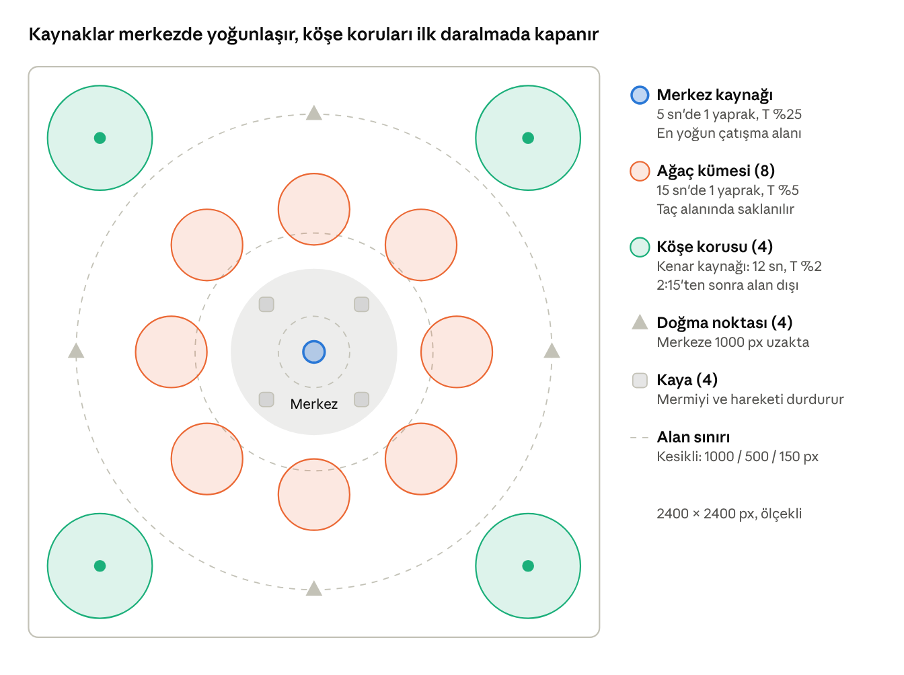
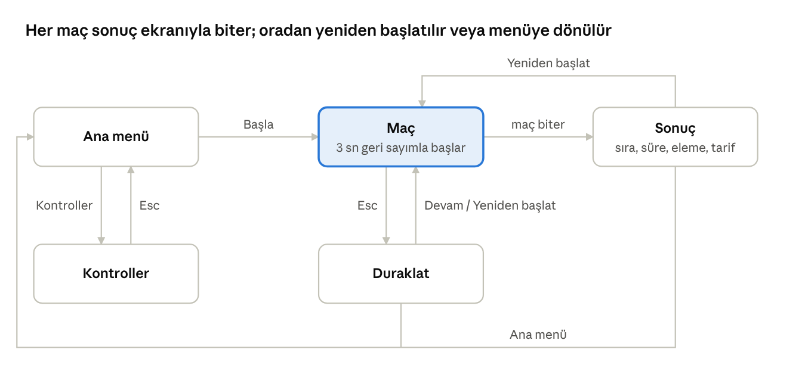
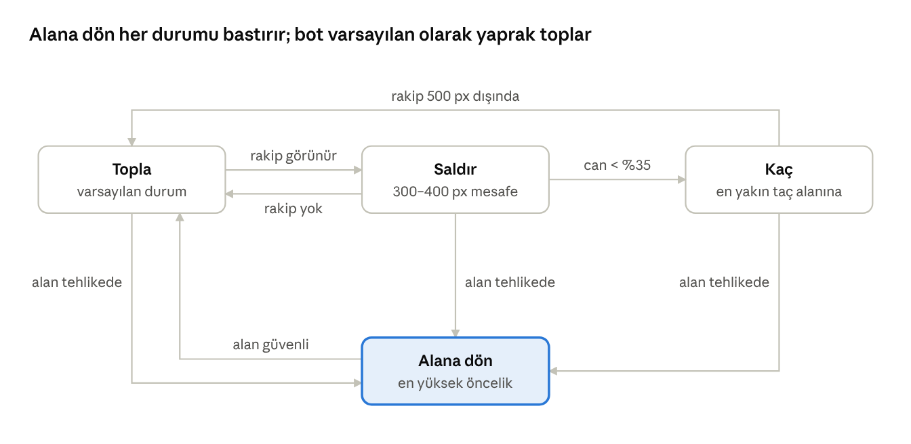

# Leaf Brawl – Yazılım Gereksinimleri Spesifikasyonu (Demo v1.0)

23 Ekim 2026 · Yiğit Ahmet Hosta

## 1. Giriş

Bu belge, Leaf Brawl'ın ilk ve tek demosunu tanımlar: 1 insan oyuncu ile 3 botun yerel bilgisayarda, internet bağlantısı olmadan oynadığı tek haritalı, 5 dakikalık eleme maçı. Belge sonraki sürümleri öngörmez; burada yazmayan her şey demonun dışındadır.

### 1.1 Amaç

Demonun tek amacı şu soruyu yanıtlamaktır: Oyuncu birkaç dakika içinde yaprak toplama, tarif üretme ve bu gelişimi savaşta kullanma döngüsünü eğlenceli buluyor mu? Belge geliştirici, tasarımcı ve test eden kişi için ortak ölçüttür.

### 1.2 Kapsam

- Tek insan oyuncu, 3 bilgisayar kontrollü rakip (bot), toplam 4 karakter.
- Tek, elle tasarlanmış sonbahar haritası.
- Yeniden doğma yok; ölen karakter elenir.
- 4 yaprak türü, 3 tarif, basit yaprak yığını göstergesi, daralan güvenli alan.
- Yalnızca yerel çalışma: sunucu, çevrim içi bağlantı, hesap, yayınlama (deploy) yok.

### 1.3 Tanımlar ve kısaltmalar

| Terim | Anlamı |
| --- | --- |
| Oyuncu | Klavye ve fareyle oynayan tek insan kullanıcı |
| Bot | Oyun tarafından yönetilen rakip karakter |
| Karakter | Oyuncu veya bot; haritadaki savaşan birim |
| K / S / Y / T | Kırmızı / Sarı / Yeşil / Turuncu yaprak |
| Tarif | Belirli yaprakları harcayarak kalıcı stat artışı veren üretim |
| Tehdit puanı | Karakterin maç içinde ürettiği toplam tarif sayısı |
| Yaprak yığını | Tehdit puanını gösteren, karakterin etrafındaki yaprak görseli |
| Güvenli alan | Dışında karakterin hasar aldığı, zamanla küçülen daire |
| FR / NFR | Fonksiyonel / fonksiyonel olmayan gereksinim |
| px | Dünya birimi; 1 px = kamera yakınlaştırması 1 iken 1 ekran pikseli |

### 1.4 Referanslar

- *Leaf Brawl – Ana Oyun Konsepti* (ekip belgesi). Bu SRS, konseptin MVP bölümünü tek oyunculu demoya indirger.
- IEEE 830 / ISO/IEC/IEEE 29148 yapısı esas alınmıştır.

## 2. Genel Tanım

Demo, tek bir bilgisayarda açılıp kapanan, kendi içinde tamamlanmış bir oyundur. Dış sisteme bağımlılığı yoktur.

### 2.1 Ürün perspektifi

- Bağımsız, çevrimdışı bir uygulamadır. Ağ isteği, sunucu, veritabanı veya kullanıcı hesabı içermez.
- Botlar aynı süreç içinde, oyunun kendi döngüsünde çalışır.
- Teslim biçimi: geliştiricinin bilgisayarında çalıştırılan masaüstü yapısı veya yerel olarak açılan tarayıcı yapısı. Herkese açık bir adrese yüklenmez.

### 2.2 Temel işlevler

1. Ana menüden maç başlatma.
2. Karakteri hareket ettirme, nişan alıp saldırma, atılma (dash) yeteneğini kullanma.
3. Ağaçlardan ve kaynak noktalarından düşen yaprakları toplama.
4. Üç tariften birini üreterek güç, hız veya maksimum canı artırma.
5. Botlarla savaşma; tehdit puanına göre büyüyen yaprak yığınını görme.
6. Daralan güvenli alan içinde hayatta kalma; son kalan karakter kazanır.
7. Sonuç ekranında sıralamayı görüp maçı yeniden başlatma.

### 2.3 Kullanıcı

Tek kullanıcı profili vardır: demoyu deneyen oyuncu (ekip üyesi, jüri veya test katılımcısı). Üstten görünümlü nişan alma oyunlarına aşina olduğu varsayılır; oyun içi eğitim bölümü yoktur, kontroller ana menüde tek ekranda anlatılır.

### 2.4 Kısıtlar

- Platform: macOS veya Windows dizüstü/masaüstü bilgisayar, klavye + fare. Dokunmatik ve gamepad desteklenmez.
- Motor ve dil ekip tercihidir (ör. Godot 4 veya Phaser 3); tek şart çevrimdışı yerel çalışmasıdır.
- Tüm görsel ve sesler ekibin kendi üretimi veya lisansı açık (CC0 vb.) varlıklar olmalıdır. Brawl Stars ve Minecraft'a ait hiçbir görsel, ses, kod, isim veya arayüz düzeni kullanılmaz.
- Arayüz dili Türkçedir.

### 2.5 Varsayımlar

- Bölüm 3'teki sayısal değerler ilk denge tahminidir; demo testlerinde değiştirilebilir ve bu nedenle tek bir ayar dosyasında tutulur (NFR-05).
- Bir maç tek oturumda oynanır; ilerleme, kayıt veya skor saklanmaz.

## 3. Oyun Kuralları ve Sayısal Değerler

Bütün karakterler (oyuncu ve botlar) aynı kurallara ve aynı başlangıç değerlerine tabidir. Botlara gizli bonus verilmez. Aşağıdaki değerler ilk denge tahminidir.

### 3.1 Karakter istatistikleri

| Stat | Başlangıç | Tarif başına artış | En fazla tarif | Üst sınır |
| --- | --- | --- | --- | --- |
| Güç seviyesi (vuruş hasarı) | 1 (10 hasar) | +1 seviye (+3 hasar) | 5 | 6 (25 hasar) |
| Hız (px/sn) | 220 | +%8 başlangıç değerinin (+17,6) | 4 | 290 |
| Maksimum can | 100 | +10 (mevcut can da +10) | 5 | 150 |

Hasar formülü: vuruş hasarı = 7 + 3 × Güç seviyesi. Pasif can yenilenmesi yoktur.

### 3.2 Saldırı ve yetenek

| Eylem | Tuş | Değerler |
| --- | --- | --- |
| Yaprak fırlatma (temel saldırı) | Sol fare tuşu | Mermi hızı 650 px/sn, menzil 450 px, bekleme 0,45 sn, isabet yarıçapı 8 px |
| Atılma (dash) | Boşluk | Hareket yönünde 0,15 sn'de 160 px, bekleme 4 sn, hasar almayı engellemez |

Karakter çarpışma yarıçapı 20 px'tir. Dost ateşi kavramı yoktur; her mermi fırlatan dışındaki herkese hasar verir.

### 3.3 Yaprak türleri ve kaynakları

| Kaynak | Adet | Üretim aralığı | Düşen yaprak | Turuncu olasılığı |
| --- | --- | --- | --- | --- |
| Merkez kaynağı | 1 | 5 sn | 1 | %25 |
| Ağaç kümesi | 8 | 15 sn | 1 | %5 |
| Kenar kaynağı (köşe koruları) | 4 | 12 sn | 1 | %2 |

- Turuncu olmayan yaprak K, S, Y arasında eşit olasılıkla seçilir.
- Yaprak, kaynağın 120 px çevresinde rastgele bir noktaya düşer.
- Maç başında her ağaç kümesinin çevresinde 3, merkezde 2 yaprak hazır bulunur (merkezdekilerden biri turuncu).
- Yerdeki bir yaprak 45 sn sonra kaybolur. Haritada aynı anda en fazla 80 yaprak bulunur; sınır doluyken kaynak üretmez.
- Karakter bir yaprağa 32 px yaklaşınca yaprak otomatik toplanır.
- Envanter sınırı: K, S, Y için 15'er; T için 5. Sınırdaki tür toplanmaz, yerde kalır.

### 3.4 Tarifler

| Tarif | Gereken yapraklar | Sonuç |
| --- | --- | --- |
| Güç geliştirmesi | 4 K + 1 Y + 1 T | Güç seviyesi +1 |
| Hız geliştirmesi | 4 S + 1 K + 1 T | Hız +%8 |
| Sağlık geliştirmesi | 4 Y + 1 S + 1 T | Maksimum can +10, mevcut can +10 |

Üretim anında gerçekleşir; bekleme veya üretim süresi yoktur. Statı üst sınırdaki tarif üretilemez.

### 3.5 Güvenli alan aşamaları

Alan, harita merkezinde sabit bir dairedir. Dışındaki karakter saniyede aşağıdaki hasarı alır. Daralma sırasında yarıçap doğrusal azalır.

| Aşama | Zaman | Yarıçap (px) | Dışarıda hasar |
| --- | --- | --- | --- |
| Başlangıç | 0:00–1:30 | 1700 (tüm harita) | — |
| 1. daralma | 1:30–2:15 | 1700 → 1000 | 4 / sn |
| Bekleme | 2:15–3:00 | 1000 | 4 / sn |
| 2. daralma | 3:00–3:45 | 1000 → 500 | 7 / sn |
| 3. daralma | 3:45–4:30 | 500 → 150 | 10 / sn |
| Son daralma | 4:30–5:00 | 150 → 0 | 15 / sn |

Bir sonraki daralmaya 10 sn kala yeni sınır yerde çizgiyle gösterilir. 1. daralma bittiğinde köşe koruları alan dışında kalır. Maç en geç 5:00'te biter.

### 3.6 Tehdit puanı ve yaprak yığını

Tehdit puanı = karakterin maçta ürettiği toplam tarif sayısı. Yığın kademesi bu puana göre belirlenir.

| Tehdit puanı | Yığın kademesi | Görsel | Ağaç altında saklanabilir mi |
| --- | --- | --- | --- |
| 0–1 | Yok | Yalnızca karakter | Evet |
| 2–3 | Küçük | 6 yaprak, karakter yarıçapının 1,2 katı | Evet |
| 4–5 | Orta | 12 yaprak, 1,4 kat | Hayır |
| 6 ve üzeri | Büyük | 18 yaprak, 1,6 kat | Hayır |

- Yığının baskın rengi en çok üretilen tarifin rengidir (Güç = K, Hız = S, Sağlık = Y); eşitlikte renkler karışık görünür.
- Karakter 2 veya daha fazla T taşıyorsa yığında turuncu parıltı görünür.
- Yığın karakterin yön okunu ve silueti kapatmaz; karakter yığının üstünde çizilir.

### 3.7 Ölüm ganimeti

Ölen karakterin envanterinden K, S, Y türlerinin her birinin %35'i (aşağı yuvarlanır) ve T'nin %60'ı (yukarı yuvarlanır) öldüğü noktanın 80 px çevresine saçılır. Kalan yapraklar yok olur. Saçılan yapraklar 80 yaprak sınırına sayılmaz.

### 3.8 Harita düzeni

Harita sabittir ve elle tasarlanır. Merkezdeki 8 ağaç kümesi aralarında dar geçitler bırakır; köşe koruları merkeze 1270 px uzaklıkta olduğundan 1. daralma bitince alan dışında kalır. Her doğma noktası iki köşe korusunun ortasında, merkeze 1000 px uzaklıktadır.

## 4. Fonksiyonel Gereksinimler

Tüm gereksinimler demo için zorunludur. Her gereksinim Bölüm 9'daki kabul testleriyle doğrulanır.

### 4.1 Ekran ve maç akışı

Demoda 5 ekran vardır; ana menüdeki "Çıkış" uygulamayı kapatır. Duraklatma ve sonuç ekranları hem yeniden başlatmaya hem ana menüye geçiş verir.

| No | Gereksinim |
| --- | --- |
| FR-01 | Uygulama açıldığında ana menü gösterilir: "Başla", "Kontroller", "Çıkış". |
| FR-02 | "Kontroller" ekranı tüm tuşları ve 3 tarifi tek sayfada gösterir. |
| FR-03 | "Başla" ile 1 oyuncu ve 3 bot, haritanın 4 doğma noktasına rastgele dağıtılarak maç başlar. |
| FR-04 | Maç başında 3 sn geri sayım olur; bu sürede hiçbir karakter hareket edemez ve saldıramaz. |
| FR-05 | Esc tuşu maçı duraklatır (tüm zamanlayıcılar durur). Duraklatma menüsü: "Devam", "Yeniden başlat", "Ana menü". |
| FR-06 | Oyuncu elendiğinde veya son hayatta kalan olduğunda sonuç ekranı açılır. |
| FR-07 | Sonuç ekranı oyuncunun sırasını (1.–4.), hayatta kalma süresini, elediği rakip sayısını ve ürettiği tarif sayısını gösterir; "Yeniden başlat" ve "Ana menü" seçenekleri sunar. |

### 4.2 Hareket ve kamera

| No | Gereksinim |
| --- | --- |
| FR-10 | Oyuncu W/A/S/D ile 8 yönde hareket eder; çapraz hareket hızı düz hareketle aynıdır. |
| FR-11 | Karakter fare imlecine doğru döner; yönü bir okla görünür. |
| FR-12 | Karakterler ağaç gövdelerinden, kayalardan ve harita sınırından geçemez; birbirlerinin içinden geçebilir. |
| FR-13 | Kamera oyuncuyu ortalar ve yaklaşık 1600×900 px'lik dünya alanı gösterir. Oyuncu elendiğinde kamera durur. |

### 4.3 Savaş

| No | Gereksinim |
| --- | --- |
| FR-20 | Sol tık, imleç yönünde bir yaprak mermisi fırlatır; bekleme süresi dolmadan yeni atış yapılmaz. Tuş basılı tutulursa bekleme bittikçe otomatik atış yapılır. |
| FR-21 | Mermi bir karaktere değdiğinde fırlatanın güncel vuruş hasarı kadar can azaltır ve yok olur. Ağaç gövdesine, kayaya veya menzil sonuna ulaşınca da yok olur. |
| FR-22 | Boşluk tuşu atılmayı tetikler; hareket tuşu basılı değilse karakterin baktığı yöne atılır. |
| FR-23 | Hasar alan karakter 0,1 sn beyaz yanıp söner ve üstünde hasar sayısı belirir. |
| FR-24 | Can 0'a düştüğünde karakter ölür (FR-80). |

### 4.4 Yaprak toplama

| No | Gereksinim |
| --- | --- |
| FR-30 | Kaynaklar Bölüm 3.3'teki aralık ve olasılıklarla yaprak üretir. |
| FR-31 | Yaprak düşerken kısa bir süzülme animasyonu (en fazla 0,6 sn) oynar; yere değmeden toplanamaz. |
| FR-32 | Karakter 32 px yakınındaki yaprağı otomatik toplar; envanter sınırı doluysa toplamaz. |
| FR-33 | Kaybolmasına 5 sn kalan yaprak yanıp söner. |

### 4.5 Envanter ve tarif üretimi

| No | Gereksinim |
| --- | --- |
| FR-40 | Tab tuşu envanter panelini açıp kapatır. Panel açıkken oyun durmaz; karakter hareket edebilir, saldıramaz. |
| FR-41 | Panel 4 yaprak yuvasını (adet / sınır) ve 3 tarif kartını gösterir. Her kart gereken, sahip olunan ve eksik yaprak miktarlarını yazar. |
| FR-42 | Üretilebilir kart vurgulanır; üretilemeyen kart soluk görünür ama gizlenmez. Statı üst sınırda olan kartta "En üst seviye" yazar. |
| FR-43 | Bir tarif paneldeki kartına tıklanarak veya panel kapalıyken 1 (Güç), 2 (Hız), 3 (Sağlık) tuşuyla üretilir. |
| FR-44 | Üretimde gereken yapraklar envanterden düşülür, stat anında artar ve tehdit puanı 1 artar. |
| FR-45 | Üretimde kısa (en fazla 0,5 sn) yaprak birleşme efekti ve ses çalar; ekranda 2 sn "Güç 2 → 3" biçiminde bildirim görünür. |
| FR-46 | Yeterli yaprak yokken 1/2/3 tuşuna basılırsa üretim olmaz ve ilgili yaprak ikonları kısa süre kırmızı çerçeveyle işaretlenir. |

### 4.6 Saklanma ve görüş

| No | Gereksinim |
| --- | --- |
| FR-50 | Her ağaç kümesinin ve köşe korusunun bir taç (yaprak örtüsü) alanı vardır. |
| FR-51 | Taç alanındaki karakter, kendisine 160 px'ten uzak olan diğer karakterlere görünmez. Bu kural botlar için de geçerlidir. |
| FR-52 | Oyuncu taç alanındayken kendi karakteri yarı saydam çizilir. |
| FR-53 | Yığın kademesi Orta veya Büyük olan karakter taç alanında da görünür kalır. |
| FR-54 | Mermiler taç alanından geçer; yalnızca gövde ve kayalar mermiyi durdurur. |

### 4.7 Yaprak yığını

| No | Gereksinim |
| --- | --- |
| FR-60 | Her karakterin yığın kademesi tehdit puanına göre Bölüm 3.6'daki gibi güncellenir. |
| FR-61 | Kademe arttığında yığın 0,3 sn içinde büyür. |
| FR-62 | Yığın karakterle birlikte hareket eder, hafifçe salanır ve oyuncunun kontrolünü veya görüşünü engellemez. |
| FR-63 | Karakterlerin üzerinde isim yazmaz; oyuncu kendi karakterini ayak altındaki halkadan tanır. |

### 4.8 Güvenli alan

| No | Gereksinim |
| --- | --- |
| FR-70 | Güvenli alan Bölüm 3.5'teki zamanlamayla daralır. |
| FR-71 | Alan dışı ekranda renkli bir örtüyle gösterilir; oyuncu alan dışındayken ekran kenarları kırmızılaşır. |
| FR-72 | Alan dışındaki karaktere her 0,5 sn'de, saniyelik hasarın yarısı kadar hasar uygulanır. |
| FR-73 | Alan dışında kalan kaynaklar yaprak üretmeyi bırakır. |

### 4.9 Ölüm, elenme ve sıralama

| No | Gereksinim |
| --- | --- |
| FR-80 | Ölen karakter haritadan kaldırılır ve yeniden doğmaz. Yerine 1 sn süren bir yaprak dağılma efekti oynar. |
| FR-81 | Ölüm ganimeti Bölüm 3.7'ye göre yere saçılır. |
| FR-82 | Sıralama ölüm sırasına göredir: ilk ölen 4., son kalan 1. olur. |
| FR-83 | Aynı karede birden fazla karakter ölürse, ölümden önceki canı yüksek olan üst sıraya yazılır; can eşitse aynı sırayı paylaşırlar. Son iki karakter aynı anda ölürse aynı kural kazananı belirler. |
| FR-84 | Bir rakibin son vuruşunu yapan karakterin eleme sayısı 1 artar. Alan hasarıyla ölenlerde eleme kimseye yazılmaz. |
| FR-85 | Oyuncu elendiğinde maç ekranda donar ve sonuç ekranı açılır; kalan botların maçı arka planda sürdürülmez. |

## 5. Bot Gereksinimleri

Demoda 3 bot bulunur ve tek zorluk seviyesi vardır. Botlar oyuncuyla aynı kuralları kullanır; tek farkları girdilerini klavye yerine karar mantığından almalarıdır. Bot mantığı 4 durumlu basit bir durum makinesidir.

"Alan tehlikede" = bot alan dışında veya 10 sn içinde alan dışında kalacak. "Rakip görünür" = 500 px içinde görünen rakip var ve can %35 veya üstünde. Eşikler BOT-04–BOT-07'de tanımlıdır.

### 5.1 Bot profilleri

| Bot | Tarif önceliği | Yığının baskın rengi (beklenen) |
| --- | --- | --- |
| Saldırgan | Güç → Sağlık → Hız | Kırmızı |
| Çevik | Hız → Güç → Sağlık | Sarı |
| Dayanıklı | Sağlık → Güç → Hız | Yeşil |

### 5.2 Davranış kuralları

| No | Gereksinim |
| --- | --- |
| BOT-01 | Bot, oyuncuyla aynı stat, bekleme süresi, envanter sınırı ve tariflere tabidir; gizli bonus almaz. |
| BOT-02 | Bot yalnızca 650 px içindeki karakterleri ve yaprakları algılar; FR-51'e göre görünmeyen karakteri algılayamaz. Kaynakların sabit konumlarını ve güvenli alanı her zaman bilir. |
| BOT-03 | Bot her 0,2 sn'de bir karar verir; durum seçimi öncelik sırasıyla Alana dön > Kaç > Saldır > Topla'dır. |
| BOT-04 | **Alana dön:** Bot alan dışındaysa veya 10 sn içinde alan dışında kalacaksa merkeze doğru gider; alan dışındayken atılmayı kullanır. |
| BOT-05 | **Kaç:** Canı %35'in altındaysa ve 500 px içinde rakip varsa rakipten uzaklaşıp en yakın taç alanına gider; rakip 200 px'ten yakınsa atılmayı kullanır. |
| BOT-06 | **Saldır:** Canı %35 veya üstündeyse ve 500 px içinde görünen rakip varsa hedefle 300–400 px mesafeyi korur, yana kayarak ateş eder. |
| BOT-07 | **Topla:** Diğer durumlarda en yakın görünen yaprağa gider. Görünen yaprak yoksa canı %60 veya üstündeyse merkez kaynağına, değilse alan içindeki en yakın ağaç kümesine veya kenar kaynağına gider. |
| BOT-08 | Hedef seçimi: görünen rakipler arasında (yığın kademesi × 200) − mesafe değeri en yüksek olan seçilir (Yok = 0, Küçük = 1, Orta = 2, Büyük = 3). Botlar oyuncu ile botu ayırt etmez. Böylece botlar kendiliğinden en tehlikeli karaktere yönelir. |
| BOT-09 | Nişan: Bot hedefin 0,25 sn sonraki tahmini konumuna, ±8° rastgele sapmayla ateş eder. Yeni bir hedefi ilk gördükten 0,25 sn sonra ateşe başlar. |
| BOT-10 | Tarif: Bot, profil sırasındaki ilk üretilebilir tarifi yeterli yaprak oluşur oluşmaz üretir. |
| BOT-11 | Yol bulma: Bot engellerin etrafından dolaşır. 2 sn boyunca 20 px'ten az ilerlerse 200 px içinde rastgele bir noktaya yönelerek takılmadan çıkar. |
| BOT-12 | Botlar arasında ittifak, iletişim veya ortak hedef paylaşımı yoktur; aynı karaktere yönelmeleri yalnızca BOT-08'in sonucudur. |

## 6. Kullanıcı Arayüzü ve Kontroller

Maç ekranında yalnızca aşağıdaki 6 HUD öğesi bulunur; hiçbiri oyun alanının %15'inden fazlasını kaplamaz.

### 6.1 Kontroller

| Tuş | Eylem |
| --- | --- |
| W / A / S / D | Hareket |
| Fare | Nişan / bakış yönü |
| Sol tık | Yaprak fırlatma |
| Boşluk | Atılma |
| 1 / 2 / 3 | Güç / Hız / Sağlık tarifini üret |
| Tab | Envanter panelini aç / kapat |
| Esc | Duraklat |

### 6.2 HUD öğeleri

| No | Konum | İçerik |
| --- | --- | --- |
| UI-01 | Sol üst | Can çubuğu ve "85 / 110" biçiminde can / maksimum can; altında Güç seviyesi ve Hız yüzdesi |
| UI-02 | Üst orta | Maç süresi ve "Alan daralıyor: 0:12" biçiminde bir sonraki daralmaya kalan süre |
| UI-03 | Sağ üst | Hayatta kalan karakter sayısı ("Kalan: 3") ve oyuncunun eleme sayısı |
| UI-04 | Alt orta | 4 yaprak ikonu ve adetleri (K, S, Y, T); sınırdaki türün adedi farklı renkte |
| UI-05 | Sağ alt | Saldırı ve atılma ikonları; bekleme süresi dairesel dolumla ve kalan saniyeyle gösterilir |
| UI-06 | Yaprak çubuğunun üstü | Tarif üretilebilir olduğunda küçük bildirim: "Güç hazır \[1\]"; birden fazlaysa yan yana |

### 6.3 Yaprak görselleri

Yapraklar renk körlüğüne karşı renkle birlikte şekille de ayırt edilir. HUD, envanter, yerdeki yaprak ve yığın aynı şekilleri kullanır.

| Yaprak | Renk | Şekil |
| --- | --- | --- |
| K (güç) | Kırmızı | Sivri, üç uçlu |
| S (hız) | Sarı | İnce ve uzun |
| Y (sağlık) | Yeşil | Yuvarlak |
| T (katalizör) | Turuncu | Yıldız damarlı, parlayan kenarlı |

### 6.4 Diğer ekranlar

- Ana menü, kontroller, duraklatma ve sonuç ekranları tek sütunlu, en fazla 4 düğmeli basit panellerdir.
- Tüm düğmeler fareyle tıklanabilir; Esc bir önceki ekrana döner.

## 7. Fonksiyonel Olmayan Gereksinimler

| No | Alan | Gereksinim |
| --- | --- | --- |
| NFR-01 | Performans | 4 karakter, 80 yaprak ve tüm mermiler ekrandayken Apple M1 veya Intel i5 (8. nesil, tümleşik grafik) düzeyinde bir dizüstü bilgisayarda 1920×1080 çözünürlükte en az 60 FPS. |
| NFR-02 | Tepki süresi | Tuşa basış ile ekrandaki hareket arasında en fazla 1 kare gecikme. |
| NFR-03 | Açılış | Uygulama açılışından ana menüye 10 sn, "Başla"dan geri sayıma 3 sn içinde. |
| NFR-04 | Çevrimdışı çalışma | Uygulama hiçbir ağ isteği yapmaz; internet kapalıyken tüm işlevler çalışır. Hesap, telemetri, reklam, analiz ve kayıt dosyası yoktur. |
| NFR-05 | Ayarlanabilirlik | Bölüm 3'teki tüm sayısal değerler tek bir ayar dosyasında (ör. JSON) tutulur; kod değişmeden düzenlenebilir. Aynı dosyada test için oyuncunun başlangıç envanteri ve bot sayısı (0–3) ayarlanabilir; bu ayarlar demo yapısında varsayılan değerlerdedir. |
| NFR-06 | Kararlılık | 10 ardışık maçta çökme, donma veya botun 2 sn'den uzun takılı kalması olmaz. |
| NFR-07 | Tekrarlanabilirlik | Rastgelelik tek bir tohum (seed) değerinden üretilir; ayar dosyasında sabit tohum verildiğinde aynı maç başlangıcı ve kaynak üretimi tekrarlanır (hata ayıklama için). |
| NFR-08 | Erişilebilirlik | Yapraklar şekille ayrılır (Bölüm 6.3). HUD yazıları 1080p'de en az 18 px; metin ile arka plan kontrastı en az 4.5:1. |
| NFR-09 | Özgünlük | Tüm karakter, yaprak, harita, arayüz, ses ve kod ekibe aittir veya açık lisanslıdır; lisanslar bir `CREDITS` dosyasında listelenir. Referans oyunlardan hiçbir varlık veya isim kullanılmaz. |
| NFR-10 | Ses | Saldırı, isabet, yaprak toplama, tarif üretimi, ölüm ve alan uyarısı için birer kısa ses efekti; müzik zorunlu değildir. Duraklatma menüsünde ses açma/kapama düğmesi bulunur. |
| NFR-11 | Dağıtım | Demo tek bir klasör veya çalıştırılabilir dosya olarak, kurulum gerektirmeden açılır. Herhangi bir sunucuya veya mağazaya yüklenmez. |

## 8. Kapsam Dışı

Aşağıdakiler demoda yoktur ve demo için tasarım, kod veya altyapı hazırlığı yapılmaz.

| Konu | Demodaki karşılığı |
| --- | --- |
| Çevrim içi çok oyunculu, eşleştirme, sunucu, deploy | Yok; yalnızca yerel tek oyuncu |
| Aynı bilgisayarda ikinci insan oyuncu | Yok |
| 10 oyunculu maç | Yok; maç sabit 4 karakterlidir |
| Birden çok bot zorluk seviyesi | Yok; tek seviye |
| İzleyici modu | Yok; oyuncu elenince sonuç ekranı açılır |
| Dengeli geliştirme, Acil iyileşme, Kaçış tarifleri, kalkan | Yok; yalnızca 3 tarif |
| Aynı alanda uzun kalınca yaprak üretiminin azalması | Yok; pasif oyunu alan daralması çözer |
| Zamanlı etkinlikler, özel ağaç türleri | Yok |
| Mini harita, ekran dışı yığın göstergesi | Yok |
| Birden çok karakter veya harita | Yok; tek karakter modeli, tek harita |
| Hesap, ilerleme kaydı, skor tablosu, kozmetik, mağaza | Yok |
| Gamepad, dokunmatik, mobil | Yok |
| Oyun içi eğitim bölümü | Yok; tek sayfalık kontroller ekranı |
| Ayar menüsü (çözünürlük, tuş atama) | Yok; yalnızca ses aç/kapa |

## 9. Kabul Kriterleri

Demo, aşağıdaki 14 testin tümü geçtiğinde tamamlanmış sayılır. Testler internet bağlantısı kapalı bir bilgisayarda yapılır.

### 9.1 Kabul testleri

| No | Adımlar | Beklenen sonuç | İlgili |
| --- | --- | --- | --- |
| KT-01 | Uygulamayı aç, "Başla"ya bas | 3 sn geri sayımdan sonra oyuncu ve 3 bot farklı doğma noktalarında hareket eder | FR-01, FR-03, FR-04 |
| KT-02 | 30 sn boyunca W/A/S/D ve fareyle dolaş | Karakter 8 yönde 220 px/sn hızla hareket eder, gövde ve kayalardan geçemez | FR-10–FR-12 |
| KT-03 | Bir botu 10 kez vur | Başlangıç statıyla bot 10. isabette ölür; yere ganimet saçılır | FR-20–FR-24, FR-81 |
| KT-04 | Merkeze git, 60 sn yaprak topla | Yapraklar otomatik toplanır, HUD adetleri doğru artar, sınırdaki tür toplanmaz | FR-30–FR-32, UI-04 |
| KT-05 | 4 K + 1 Y + 1 T ile 1'e bas | Güç 1 → 2 olur, "Güç 1 → 2" bildirimi çıkar, 6 yaprak düşer, vuruş hasarı 13 olur | FR-43–FR-45 |
| KT-06 | Yaprak yetmezken 2'ye bas | Hiçbir stat değişmez, eksik yaprak ikonları kırmızı çerçevelenir | FR-46 |
| KT-07 | Tab ile paneli aç | 3 kart görünür; üretilebilir olan vurgulu, diğerleri soluk ama okunur; karakter hareket eder, ateş etmez | FR-40–FR-42 |
| KT-08 | Hata ayıklama ayarıyla 6 tarif üret | Yığın 2'de Küçük, 4'te Orta, 6'da Büyük olur; yön oku görünür kalır | FR-60–FR-62 |
| KT-09 | Tehdit puanı 0 iken bir taç alanına gir, botu 160 px'ten uzakta bekle | Bot oyuncuyu hedef almaz; puan 4 iken aynı testte hedef alır | FR-51, FR-53, BOT-02 |
| KT-10 | Maçı 1:30'a kadar köşede bekle | Alan daralır, dışarıda 4 hasar/sn alınır, ekran kenarları kırmızılaşır, köşe kaynağı üretmeyi bırakır | FR-70–FR-73 |
| KT-11 | Oyuncu ölünceye kadar oyna | Oyuncu yeniden doğmaz; sonuç ekranı doğru sırayı, süreyi, eleme ve tarif sayısını gösterir | FR-06, FR-07, FR-80–FR-85 |
| KT-12 | Hiç saldırmadan alan içinde hayatta kalmaya çalış | Maç en geç 5:00'te tek kazanan veya FR-83'e göre sıralamayla biter | FR-70, FR-83 |
| KT-13 | 3 botu 5 maç boyunca izle | Her bot en az 1 tarif üretir, alan dışında 3 sn'den uzun kalmaz, 2 sn'den uzun takılmaz | BOT-01–BOT-11 |
| KT-14 | Ağı kapat, 10 maç üst üste oyna, FPS sayacını aç | Çökme yok, FPS 60'ın altına düşmez, ağ isteği yapılmaz | NFR-01, NFR-04, NFR-06 |

### 9.2 Demo değerlendirmesi

Kabul testleri geçtikten sonra en az 5 kişi demoyu 3'er maç oynar ve her maçtan sonra şu soruları 1–5 arasında puanlar:

1. Yaprak toplamak ve tarif üretmek eğlenceli miydi?
2. Tarif seçimi oynayışını değiştirdi mi?
3. Yaprak yığınına bakarak tehlikeli rakibi tanıyabildin mi?
4. Maç süresi ve alan daralması uygun hızda mıydı?
5. Bir maç daha oynamak ister misin?

Ortalama puan 3,5 veya üzerindeyse döngü eğlenceli kabul edilir. Bu eşik ekip tarafından değiştirilebilir; karşılanmazsa Bölüm 3'teki değerler ayar dosyasından düzenlenerek test tekrarlanır.
